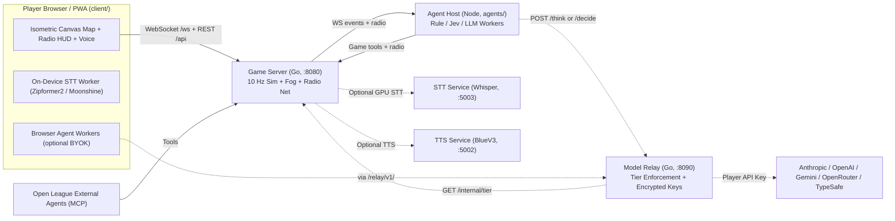

# System Architecture

Callsign separates deterministic simulation, AI billing/routing, voice services, and browser UI into clean services orchestrated via `docker-compose.yml`.

## Repository Layout

| Directory | Language / Runtime | Responsibility |
|---|---|---|
| `server/sim/` | Go | Authoritative deterministic simulation (`10 ticks/s`), pathing, fog of war, combat, economy, structures, heroes, sorties. |
| `server/room/` | Go | Multi-room hub, lobbies, seat tokens, WebSocket fan-out, command authorization, Anvil cues, traffic prioritization. |
| `server/radio/` | Go | Bilingual callsign, map-point, landmark, and proword parser & router. |
| `server/bot/` | Go | Built-in scripted opponent (`easy`, `normal`, `standard`/`relentless`, `rush`). |
| `relay/` | Go | Encrypted player API key store (`.relay-data/`), model selection from `shared/models.json`, chat & Jev decision proxying. |
| `shared/` | Go + JSON | `rules.json` (game balance/maps/radio) and `models.json` (tier-to-model mapping). |
| `agents/` | Node.js / ESM | Agent runtime (`agent.mjs`), prompts, tools, rule brain (`brain-rule.mjs`, `rule-grammar.mjs`), Jev brain (`brain-jev.mjs`), relay/Claude brains. |
| `client/` | Vanilla JS + CSS + PWA | Isometric canvas renderer (`art.js`, `map.js`, `terrain.js`), mobile & RTL HUD, service worker (`sw.js`), on-device voice (`client/voice/`). |
| `stt/` & `tts/` | Python (Docker) | Optional GPU Whisper transcription service (`callsign-stt`) and radio voice synthesis service (`callsign-tts`). |
| `art/` | Python (Blender + ComfyUI) | Offline sprite pipelines (`units.py`, `props.py`, `paint.py`, `generate.py`, `sheet.py`). |

## Key Engineering Properties
- **Determinism**: Same random seed + commands produces identical state hashes across all three maps, verified in `server/sim/` tests.
- **Prompt Injection Defense**: Agents never receive enemy free-text—only structured fog-filtered game snapshots and their own side's radio traffic.
- **Resilience**: If a player backgrounds their phone or the relay goes down, squads keep executing their last orders and server fireteam AI keeps fighting.

## Related Notes
- [[Home]]
- [[Locked Decisions]]
- [[AI Brains and Model Relay]]
- [[Voice Pipeline (STT and TTS)]]
- [[Running, Deploying and Testing]]
